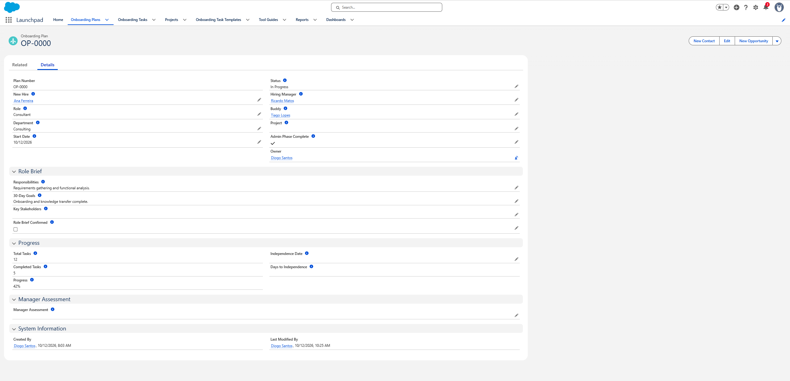
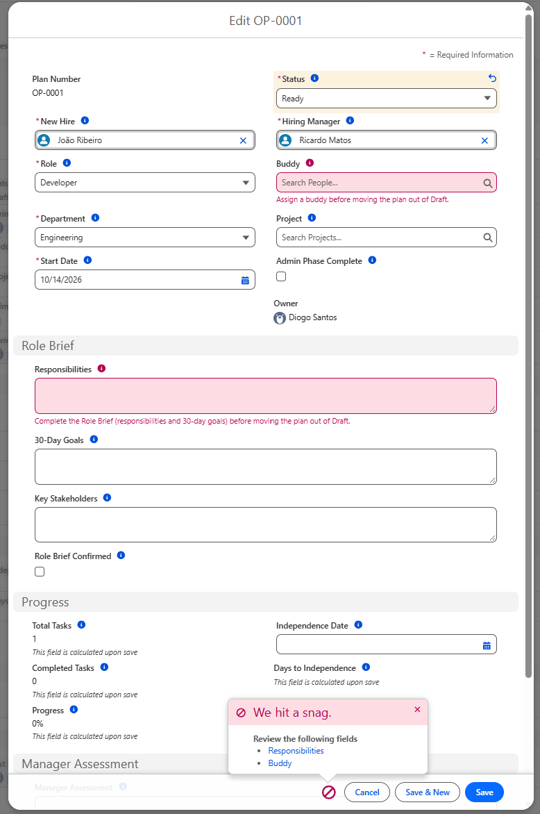
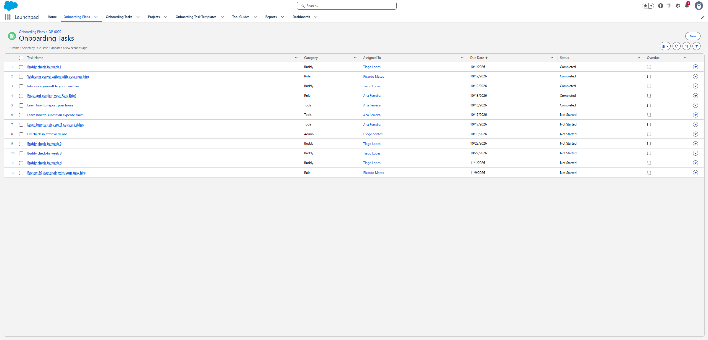

# Launchpad

**Employee onboarding on Salesforce, from role preparation to independence.**

Launchpad is a Salesforce application for a fictional Lisbon IT consultancy, Atlântica Consulting. It started as a business analysis exercise: map how onboarding works today, find where it breaks, redesign the process, and then build the redesign on the Salesforce Platform with declarative tools only (no Apex).



---

## The problem

Atlântica's administrative onboarding works: contracts get signed, laptops arrive on day one. What breaks is everything after that. The AS-IS analysis found six pain points, all in the same phase:

| | Pain point |
|---|---|
| PP-01 | Knowledge transfer into a new project is unstructured |
| PP-02 | Responsibilities are explained verbally, never written down |
| PP-03 | Internal tools (timesheets, expenses) are learned by trial and error |
| PP-04 | The same questions are answered repeatedly by different people |
| PP-05 | Nothing is tracked after day one |
| PP-06 | There is no formally assigned buddy |

Nobody owns the integration of a new hire into their role and project, so it depends on whoever has time.

## The solution

Every new hire gets one **onboarding plan** with an owner for each step:

- **Before day one**, the hiring manager writes a **Role Brief** (responsibilities, 30-day goals, key stakeholders) and assigns a **buddy**. The plan can't move forward without both.
- **When the plan starts**, Launchpad generates the onboarding tasks from templates and assigns each one to the right person: the new hire, the manager, the buddy or HR, with due dates calculated from the start date.
- **When the new hire joins a project**, the project lead automatically gets a standard **handover checklist**.
- **Tool tasks link to step-by-step Tool Guides**, so nobody has to ask how to report their hours.
- **Reminders** go out when the role isn't prepared in time and when tasks become overdue.
- **HR sees everything on a dashboard**, including average days to independence against the 3-week target.

| Plan lifecycle with validation | Tasks generated and assigned automatically |
|---|---|
|  |  |

| What a new hire sees | HR dashboard |
|---|---|
|  |  |

## Business analysis

The project is documented the way a client engagement would be. Each document builds on the previous one, and every requirement traces back to a pain point.

| Document | What it contains |
|---|---|
| [01 · AS-IS Process](docs/01-as-is-process.md) | Stakeholders, current process diagram, pain points, baseline metrics |
| [02 · TO-BE Process](docs/02-to-be-process.md) | Redesigned process, roles, pain-point traceability, target metrics, release phasing |
| [03 · Business Requirements](docs/03-brd.md) | 25 functional requirements, 12 user stories with acceptance criteria, data model, automation, security model, and the design decisions made during the build |

## What's built

Everything is declarative and stored in this repository as Salesforce metadata, so the whole app can be deployed to a fresh org.

| Area | Components |
|---|---|
| **Data model** | 5 custom objects: Onboarding Plan, Onboarding Task (master-detail with roll-up summaries), Task Template, Project, Tool Guide. Shared global value set for task categories. |
| **Automation** | 7 record-triggered Flows: manager prep task, task generation at plan start, project handover tasks, completed-date stamping, plan sharing, and two reminders using **scheduled paths** |
| **Data quality** | 7 validation rules enforcing the plan lifecycle (Draft → Ready → In Progress → Completed) |
| **Security** | Private sharing on plans, Flow-created share records for each participant, 3 permission sets (HR, Manager, Employee), and a **custom permission** checked in validation rules to protect required fields |
| **Reporting** | 2 custom report types, 4 reports, and a dynamic dashboard that respects each viewer's access |
| **User experience** | Lightning app with tabs for each object, page layouts with help text on every field |


## Personas

The demo org has one user per persona, so each view can be tested with real permissions.

| Persona | Permission set | Can do |
|---|---|---|
| HR Specialist | Launchpad HR | Everything: create plans, manage templates and guides, see all plans |
| Hiring Manager / Project Lead | Launchpad Manager | Create and run plans for their hires, manage projects |
| New Hire / Buddy | Launchpad Employee | See only the plans they're part of, confirm the Role Brief, complete their own tasks |

## Deploy it yourself

You need a free [Salesforce Developer Edition](https://developer.salesforce.com/signup) org and the [Salesforce CLI](https://developer.salesforce.com/tools/salesforcecli).

```bash
git clone https://github.com/DiogoS7/Launchpad.git
cd Launchpad
sf org login web --alias launchpad --set-default
sf project deploy start --source-dir force-app
sf org assign permset --name Launchpad_HR
sf data import tree --plan data/data-plan.json
```

Then open the **Launchpad** app from the App Launcher. To test the other personas, create users with the Salesforce Platform licence and assign them the Manager or Employee permission set. For reminder emails, set **Setup → Deliverability** to *All email*.

## Roadmap

| Release | Scope | Status |
|---|---|---|
| v1 · Core app | Everything above | ✅ Done |
| v2 · Agentforce | An employee agent that answers onboarding and tool questions from the Tool Guides and tells new hires what's next on their plan | Planned |
| v3 · Claude | Claude-assisted features, such as drafting a first Role Brief from a job description for the manager to review | Planned |

Each release lines up with a certification on my roadmap: Platform App Builder and Business Analyst for v1, Agentblazer and Agentforce Specialist for v2.

## Author

**Diogo Santos** · Business Analyst / Consultant · [LinkedIn](https://www.linkedin.com/in/diogo-santos-b22801243) · [GitHub](https://github.com/DiogoS7)
