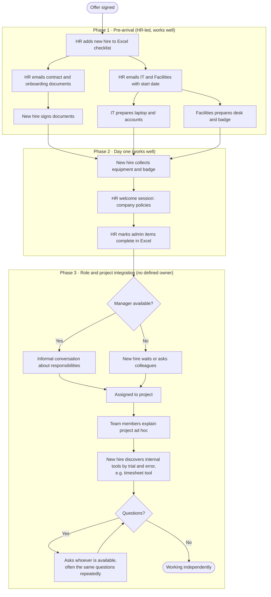

# AS-IS Process: Employee Onboarding

**Project:** Launchpad
**Document:** 01 · AS-IS Process Analysis
**Author:** Diogo Santos
**Status:** Draft v0.1

---

## 1. Purpose

This document describes how employee onboarding works today at Atlântica Consulting, before Launchpad exists. It identifies who is involved, what each step looks like, which tools are used, and where the process breaks down. It is the baseline for the TO-BE process design and the Business Requirements Document.

## 2. Business context

Atlântica Consulting is a fictional IT consultancy based in Lisbon with around 300 employees. It hires 8 to 10 people per month across consulting, development and support roles. Most new hires are placed on a client project within their first weeks.

Onboarding has no dedicated system. It runs on email, a shared Excel checklist owned by HR, and individual knowledge held by managers and team members.

## 3. Scope

**In scope:** everything from a signed offer to the new hire working independently on their first project.

**Out of scope:** recruitment and interviewing (handled in a separate process that works well), payroll setup, and offboarding.

## 4. Stakeholders

| Stakeholder | Role in onboarding | Main concern |
|---|---|---|
| HR Specialist | Owns the process; sends contracts and documents; maintains the checklist | Nothing falls through the cracks; compliance documents are signed |
| IT Support | Prepares laptop, accounts and system access | Receiving requests early enough to prepare equipment |
| Facilities | Desk, building badge, parking | Knowing start dates in advance |
| Hiring Manager | Defines responsibilities; assigns the new hire to a project | New hire becomes productive quickly |
| Project / Team Lead | Integrates the new hire into the project team | Not losing team capacity to repeated explanations |
| Buddy (informal) | Answers day-to-day questions | Often not formally assigned |
| New Hire | Completes documents; learns role, tools and project | Knowing what is expected and who to ask |

## 5. Process overview

The current process has three phases. Phases 1 and 2 are administrative and work reasonably well. Phase 3, integration into the role, team and project, has no defined owner and is where most problems occur.

## 6. Detailed process steps

| # | Step | Actor | Tool | Notes |
|---|---|---|---|---|
| 1 | Add new hire to onboarding checklist | HR Specialist | Excel (shared drive) | One row per hire; columns for each admin task |
| 2 | Send contract and onboarding documents | HR Specialist | Email, e-signature | Works well; documents returned before start date |
| 3 | Request laptop and accounts | HR Specialist → IT | Email | Usually sent 1–2 weeks before start |
| 4 | Request desk and badge | HR Specialist → Facilities | Email | Usually sent 1 week before start |
| 5 | Collect equipment and badge | New Hire | In person | Works well on day one |
| 6 | Welcome session on company policies | HR Specialist | Presentation | Generic; same for every role |
| 7 | Define responsibilities | Hiring Manager | Conversation | Not documented; depends on manager availability |
| 8 | Assign to project | Hiring Manager | Email / chat | No standard handover to the project lead |
| 9 | Explain project context | Team members | Conversation, scattered documents | Ad hoc; knowledge spread across people and folders |
| 10 | Learn internal tools (timesheets, expenses, ticketing) | New Hire | Trial and error | No guide or training; learned by asking colleagues |
| 11 | Ongoing questions | New Hire → whoever is available | Chat | No designated buddy or single source of answers |

## 7. Pain points

| ID | Pain point | Impact | Root cause |
|---|---|---|---|
| PP-01 | Knowledge transfer into a new project or team is unstructured | Slow ramp-up; new hire depends on whoever has time | No handover template or owner for project onboarding |
| PP-02 | Responsibilities are not clearly communicated | New hire unsure what is expected; risk of misaligned work | Responsibilities discussed verbally, never written down |
| PP-03 | Internal tools (e.g. timesheet reporting) are learned by trial and error | Incorrect or late time reports; repeated questions to colleagues | No tool guides or training tasks in the process |
| PP-04 | The same questions are answered repeatedly by different people | Team capacity lost; inconsistent answers | No central knowledge source |
| PP-05 | HR's checklist stops at administrative tasks | No visibility on whether the new hire is actually integrated | Phase 3 is not tracked anywhere |
| PP-06 | No formal buddy assignment | New hire does not know who to ask | Buddy role is informal and optional |

## 8. What works and should be kept

- **Recruitment and interviewing** run smoothly and are out of scope.
- **Document signing** is fast, and documents are returned before the start date.
- **Equipment retrieval** works: the laptop, accounts and badge are ready on day one.

The TO-BE process should keep these steps as they are and focus improvement on Phase 3.

## 9. Baseline metrics (assumed)

These figures are illustrative assumptions for the fictional scenario and will be used to measure the TO-BE design.

| Metric | Current estimate |
|---|---|
| Time until new hire works independently on a project | 4–6 weeks |
| Onboarding questions answered by team members per new hire, first month | 30+ |
| Onboarding tasks tracked in a system after day one | 0 |
| New hires with a formally assigned buddy | Under 25% |

## 10. Key finding

Atlântica's onboarding problem is not administrative. Contracts, equipment and access work. The gap is **role and project integration**: nobody owns it, nothing tracks it, and knowledge lives in people's heads. Launchpad should therefore focus on structuring and tracking that phase: clear responsibilities, a standard project handover, tool guides, a named buddy, and a single place to find answers.
