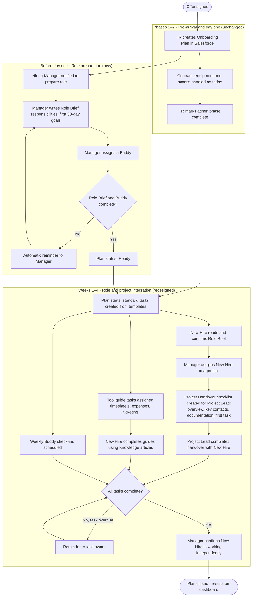

# TO-BE Process: Employee Onboarding

**Project:** Launchpad
**Document:** 02 · TO-BE Process Design
**Author:** Diogo Santos
**Status:** Draft v0.1
**Depends on:** [01 · AS-IS Process Analysis](01-as-is-process.md)

---

## 1. Purpose

This document describes how onboarding at Atlântica Consulting will work once Launchpad is in place. It redesigns Phase 3 of the current process (role and project integration), which the AS-IS analysis identified as the source of most problems, and keeps the phases that already work.

## 2. Design principles

1. **Keep what works.** Pre-arrival administration and day-one equipment handover stay as they are.
2. **Every step has an owner.** No onboarding activity depends on whoever happens to be available.
3. **Write it down once.** Responsibilities, project context and tool instructions are documented once and reused, instead of being explained repeatedly.
4. **Track until independence, not until day one.** The process ends when the new hire works independently on a project, and progress is visible throughout.
5. **Automate the routine, not the human parts.** Salesforce creates tasks, sends reminders and tracks status. Conversations with the manager, project lead and buddy stay human.

## 3. Scope

**In scope for Launchpad:** a single onboarding plan per new hire, covering role definition, buddy assignment, project handover, tool learning and progress tracking until the new hire is working independently.

**Unchanged and outside Launchpad:** recruitment, contract signing, equipment and access provisioning (Phases 1 and 2 of the AS-IS). Launchpad records that these are complete but does not replace the existing tools.

## 4. Roles in the new process

| Role | What changes |
|---|---|
| HR Specialist | Creates the onboarding plan in Salesforce instead of a row in Excel; monitors progress on a dashboard after day one |
| Hiring Manager | Writes a Role Brief before day one and assigns a buddy; both are required before the plan can start |
| Project Lead | Receives a standard Project Handover checklist automatically when the new hire joins their project |
| Buddy | Formally assigned and named in the plan; holds weekly check-ins during the first month |
| New Hire | Sees their whole onboarding in one place: responsibilities, tasks, tool guides and who to ask |
| IT Support and Facilities | No change; continue to receive requests as today |

## 5. Process overview

## 6. Detailed process steps

| # | Step | Owner | How Launchpad supports it | Automation |
|---|---|---|---|---|
| 1 | Create onboarding plan | HR Specialist | Onboarding Plan record with new hire, role, department, start date | None |
| 2 | Notify hiring manager | System | Task assigned to the manager to prepare the role | Flow on plan creation |
| 3 | Write Role Brief | Hiring Manager | Structured fields: responsibilities, 30-day goals, key stakeholders | None |
| 4 | Assign buddy | Hiring Manager | Buddy field on the plan | Validation: required before status can be Ready |
| 5 | Remind manager if incomplete | System | Reminder task or email | Scheduled Flow, 5 working days before start date |
| 6 | Complete admin phase | HR Specialist | Single checkbox confirming Phases 1–2 are done | None |
| 7 | Start plan and generate tasks | System | Onboarding tasks created from templates matching the role | Flow on status change to In Progress |
| 8 | Confirm Role Brief | New Hire | Task to read the brief and confirm, with comments | None |
| 9 | Learn internal tools | New Hire | Tasks link to Knowledge articles for each tool | Created in step 7 |
| 10 | Weekly buddy check-ins | Buddy | Four recurring tasks in the first month | Created in step 7 |
| 11 | Assign to project | Hiring Manager | Project field on the plan | None |
| 12 | Project handover | Project Lead | Handover checklist: overview, contacts, documentation links, first task | Flow when project is assigned |
| 13 | Chase overdue tasks | System | Reminder to the task owner | Scheduled Flow, daily |
| 14 | Confirm independence and close plan | Hiring Manager | Closing step with a short assessment | Validation: all tasks complete |
| 15 | Monitor progress | HR Specialist | Dashboard: plans by status, overdue tasks, average time to independence | Reports and dashboard |

## 7. Pain point traceability

Every pain point from the AS-IS analysis maps to at least one change in the new process.

| AS-IS pain point | TO-BE solution | Steps |
|---|---|---|
| PP-01 · Unstructured project knowledge transfer | Standard Project Handover checklist, owned by the Project Lead and created automatically | 11, 12 |
| PP-02 · Responsibilities not clearly communicated | Role Brief written before day one and confirmed by the new hire | 3, 8 |
| PP-03 · Internal tools learned by trial and error | Tool guide tasks linked to Knowledge articles | 9 |
| PP-04 · Same questions answered repeatedly | Knowledge articles as the single source of answers; an Agentforce agent answers from them in a later phase | 9 |
| PP-05 · No visibility after day one | All tasks tracked in Salesforce with reminders and an HR dashboard | 7, 13, 15 |
| PP-06 · No formal buddy | Buddy required before the plan can start; weekly check-ins scheduled | 4, 10 |

## 8. What stays manual, and why

- **Writing the Role Brief and the project handover.** The content depends on the role and project, and the value comes from the manager and project lead thinking it through. Launchpad structures and tracks it but doesn't generate it.
- **Buddy check-ins.** These are conversations. Launchpad schedules and records them only.
- **Confirming independence.** This is a judgement call by the manager, not a calculation.

## 9. Target metrics

Measured against the assumed baseline in the AS-IS document.

| Metric | AS-IS (assumed) | TO-BE target |
|---|---|---|
| Time until new hire works independently on a project | 4–6 weeks | 3 weeks |
| Onboarding questions answered by team members per new hire, first month | 30+ | Under 10 |
| Onboarding tasks tracked in a system after day one | 0 | All |
| New hires with a formally assigned buddy | Under 25% | 100% |

## 10. Release phasing

| Release | Scope | Related certification |
|---|---|---|
| v1 · Core app | Onboarding Plan, tasks from templates, Role Brief, buddy, project handover, Knowledge tool guides, reminders, dashboard | Platform App Builder, Business Analyst |
| v2 · Agentforce | An employee agent that answers onboarding and tool questions from the Knowledge articles and reports task status to the new hire | Agentblazer, Agentforce Specialist |
| v3 · Claude | Claude-assisted features, such as drafting a first Role Brief from a job description for the manager to review | Claude / Anthropic certifications |

## 11. Assumptions and open questions

- **A1.** Every new hire and stakeholder has a Salesforce user. In the Developer Edition org, which has a limited number of user licences, the other roles are represented by sample records for demonstration.
- **A2.** Salesforce Knowledge can be enabled in the Developer Edition org. To be verified during build; if it can't, tool guides fall back to a custom object.
- **Q1.** Should task templates differ by role (consultant, developer, support) in v1, or start with one shared template?
- **Q2.** Should the new hire be able to see their own plan in v1, or only managers and HR?

## 12. Next step

Turn this design into the Business Requirements Document: functional requirements, user stories with acceptance criteria, and the data model.
