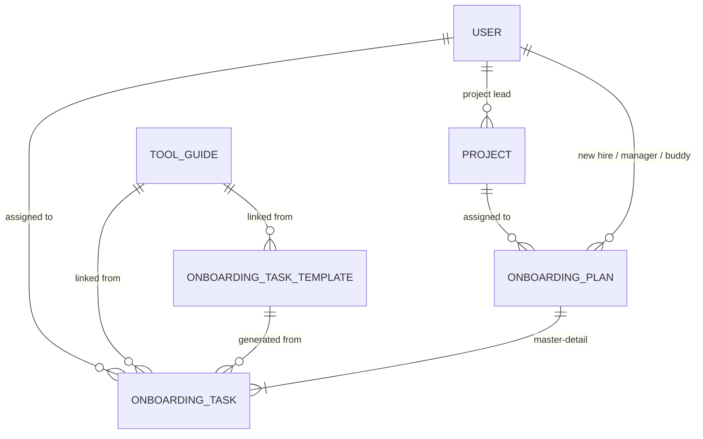

# Business Requirements Document

**Project:** Launchpad
**Document:** 03 · Business Requirements Document (BRD)
**Author:** Diogo Santos
**Status:** v0.2 (updated after build) · Scope: Release v1 (Core app)
**Depends on:** [01 · AS-IS](01-as-is-process.md) · [02 · TO-BE](02-to-be-process.md)

---

## 1. Executive summary

Atlântica Consulting's onboarding handles contracts and equipment well, but nobody owns the integration of new hires into their role and project. Responsibilities are explained verbally, project knowledge is passed on ad hoc, internal tools are learned by trial and error, and nothing is tracked after day one.

Launchpad is a Salesforce application that gives every new hire a single onboarding plan with an owner for each step, from role preparation before day one until the new hire works independently on a project. Release v1 is built entirely with declarative Salesforce features (no Apex).

## 2. Business objectives

| ID | Objective | Measure | Target |
|---|---|---|---|
| BO-01 | Reduce time to independence | Days from start date to manager confirming independence | 3 weeks (from 4–6) |
| BO-02 | Reduce repeated questions to team members | Questions per new hire in the first month (survey) | Under 10 (from 30+) |
| BO-03 | Make onboarding visible after day one | Share of onboarding tasks tracked in Salesforce | 100% |
| BO-04 | Guarantee every new hire has a support contact | Plans with an assigned buddy | 100% |

## 3. Scope

### In scope (v1)
- Onboarding plan per new hire, with status lifecycle
- Role Brief written by the hiring manager
- Mandatory buddy assignment
- Automatic task generation from a shared set of templates
- Project records and an automatic project handover checklist
- Tool guides (custom Tool Guide object) linked from tasks
- Reminders for incomplete preparation and overdue tasks
- Reports and an HR dashboard
- New hires can view their own plan and update their own tasks

### Out of scope (v1)
- Recruitment, contracts, equipment and access provisioning (existing tools remain)
- Role-specific task templates (planned for a later release; see TO-BE decision D1)
- Agentforce agent (Release v2)
- Claude-assisted features (Release v3)
- Integration with HR or IT systems
- Apex code

## 4. Assumptions and constraints

| ID | Type | Description |
|---|---|---|
| AS-01 | Assumption | All stakeholders work in Salesforce with their own user |
| AS-02 | Decision | Tool guides are a custom object, not Salesforce Knowledge (see D3) |
| CO-01 | Constraint | Built in a free Developer Edition org; user licences are limited, so demo users must be planned (check Setup → Company Information) |
| CO-02 | Constraint | v1 business logic is declarative only: objects, fields, Flows, validation rules, reports. No Apex. User-interface components may use Lightning Web Components on Lightning Data Service (see D8) |
| CO-03 | Constraint | All configuration is retrieved into source control (GitHub) |

## 5. Functional requirements

### Onboarding plan
| ID | Requirement | Priority |
|---|---|---|
| FR-01 | HR can create an onboarding plan with new hire, role, department, hiring manager and start date | Must |
| FR-02 | A plan follows the status lifecycle Draft → Ready → In Progress → Completed, with Cancelled possible from any status | Must |
| FR-03 | The hiring manager is notified with a task when a plan is created for one of their hires | Must |
| FR-04 | The hiring manager can record a Role Brief on the plan: responsibilities, 30-day goals and key stakeholders | Must |
| FR-05 | A plan cannot move to Ready unless the Role Brief and buddy are filled in | Must |
| FR-06 | If a plan is still in Draft 5 working days before the start date, the hiring manager receives a reminder | Should |
| FR-07 | HR can mark the administrative phase (contract, equipment, access) as complete | Must |
| FR-08 | A plan cannot move to In Progress unless it is Ready and the administrative phase is complete | Must |

### Tasks and templates
| ID | Requirement | Priority |
|---|---|---|
| FR-09 | HR can maintain a list of task templates, each with category, assignee role, due-day offset and optional tool guide | Must |
| FR-10 | When a plan moves to In Progress, onboarding tasks are created from all active templates triggered at plan start | Must |
| FR-11 | Each generated task is assigned to the right person (new hire, hiring manager, buddy, project lead or HR) based on the template | Must |
| FR-12 | Each generated task gets a due date calculated from the plan start date plus the template offset | Must |
| FR-13 | Tasks linked to a tool guide show a link to the related Tool Guide record | Must |
| FR-14 | Task owners receive a reminder the day after a task becomes overdue (see D4) | Should |
| FR-15 | The plan shows its progress as the percentage of tasks completed | Must |

### Projects and handover
| ID | Requirement | Priority |
|---|---|---|
| FR-16 | HR or managers can maintain project records with name, client, project lead and documentation link | Must |
| FR-17 | The hiring manager can assign a project to a plan | Must |
| FR-18 | When a project is assigned, project handover tasks are created for the project lead from templates triggered at project assignment | Must |

### Completion
| ID | Requirement | Priority |
|---|---|---|
| FR-19 | A plan cannot be Completed while it has open tasks | Must |
| FR-20 | When completing a plan, the hiring manager records the independence date and a short assessment | Must |
| FR-21 | The plan calculates days from start date to independence | Must |

### New hire experience
| ID | Requirement | Priority |
|---|---|---|
| FR-22 | The new hire can see their own plan, Role Brief, buddy, project and tasks | Must |
| FR-23 | The new hire can confirm they have read the Role Brief | Must |
| FR-24 | The new hire can update the status of tasks assigned to them | Must |

### Reporting
| ID | Requirement | Priority |
|---|---|---|
| FR-25 | HR has a dashboard showing plans by status, overdue tasks by owner and average days to independence | Must |

## 6. Non-functional requirements

| ID | Category | Requirement |
|---|---|---|
| NFR-01 | Security | New hires see only their own plan; managers see plans for their hires; HR sees all plans |
| NFR-02 | Usability | All screens use Lightning Experience; record pages are usable on mobile |
| NFR-03 | Maintainability | Every custom object and field has a description and help text |
| NFR-04 | Maintainability | API names follow a consistent convention (singular object names, no prefixes beyond `__c`) |
| NFR-05 | Maintainability | All metadata is stored in the GitHub repository and can be deployed to a fresh org |
| NFR-06 | Data quality | Required fields and validation rules prevent incomplete plans from progressing |

## 7. User stories

**US-01 · Create a plan**
As an HR Specialist, I want to create an onboarding plan for a new hire, so that their onboarding is tracked from the moment the offer is signed.
- *Given* I am an HR user, *when* I create a plan with new hire, role, department, hiring manager and start date, *then* the plan is saved with status Draft.
- *Given* the plan is saved, *then* the hiring manager receives a task to prepare the role.

**US-02 · Write a Role Brief**
As a Hiring Manager, I want to describe the new hire's responsibilities and first goals in one place, so that they know what is expected from day one.
- *Given* a plan in Draft, *when* I fill in responsibilities, 30-day goals and key stakeholders, *then* they are visible to the new hire once the plan starts.

**US-03 · Assign a buddy**
As a Hiring Manager, I want to assign a buddy, so that the new hire always knows who to ask.
- *Given* a plan without a buddy, *when* I try to set the status to Ready, *then* I see an error asking me to assign a buddy.
- *Given* a plan without a Role Brief, *when* I try to set the status to Ready, *then* I see an error asking me to complete the Role Brief.

**US-04 · Be reminded before the start date**
As a Hiring Manager, I want a reminder if the role isn't prepared, so that nothing is missing on day one.
- *Given* a plan is still in Draft 5 working days before its start date, *then* I receive a reminder task.

**US-05 · Start the plan**
As an HR Specialist, I want onboarding tasks to be created automatically when the plan starts, so that I don't have to create them by hand.
- *Given* a Ready plan with the admin phase complete, *when* I set the status to In Progress, *then* one task is created per active plan-start template.
- *Then* each task is assigned according to the template's assignee role and due on the start date plus the template offset.
- *Given* a plan that is not Ready or whose admin phase is incomplete, *when* I set it to In Progress, *then* I see an error.

**US-06 · Confirm my Role Brief**
As a New Hire, I want to read and confirm my Role Brief, so that my manager knows I understand my responsibilities.
- *Given* my plan is In Progress, *when* I open it, *then* I see my Role Brief and can mark it as confirmed.

**US-07 · Learn internal tools**
As a New Hire, I want each tool I need to learn to come with a guide, so that I don't have to ask colleagues how to report hours or expenses.
- *Given* a tool task assigned to me, *when* I open it, *then* I see a link to the Tool Guide for that tool.

**US-08 · Hand over a project**
As a Project Lead, I want a standard handover checklist when a new hire joins my project, so that I cover everything without preparing it from scratch.
- *Given* a plan In Progress, *when* the hiring manager assigns a project, *then* handover tasks are created and assigned to that project's lead.

**US-09 · Be reminded of overdue tasks**
As a task owner, I want a reminder when my onboarding task is overdue, so that the new hire isn't left waiting.
- *Given* an open task past its due date, *then* its owner receives one reminder email the day after the due date.

**US-10 · See my progress**
As a New Hire, I want to see how much of my onboarding is done, so that I know where I stand.
- *Given* a plan with tasks, *then* the plan shows the percentage of tasks completed, updated whenever a task is completed.

**US-11 · Close the plan**
As a Hiring Manager, I want to confirm when the new hire works independently, so that onboarding has a clear end.
- *Given* a plan with open tasks, *when* I set it to Completed, *then* I see an error.
- *Given* all tasks are complete, *when* I set it to Completed with an independence date and assessment, *then* the plan closes and shows days to independence.

**US-12 · Monitor onboarding**
As an HR Specialist, I want a dashboard of all onboarding plans, so that I can spot problems early.
- *Given* I open the Launchpad dashboard, *then* I see plans by status, overdue tasks by owner, and average days to independence for completed plans.

## 8. Data model

### Onboarding Plan (`Onboarding_Plan__c`)
| Field | Type | Notes |
|---|---|---|
| Name | Auto Number | `OP-{0000}` |
| New_Hire__c | Lookup (User) | Required |
| Role__c | Picklist | Consultant, Developer, Support |
| Department__c | Picklist | Consulting, Engineering, Support |
| Hiring_Manager__c | Lookup (User) | Required |
| Buddy__c | Lookup (User) | Required to reach Ready |
| Start_Date__c | Date | Required |
| Status__c | Picklist | Draft, Ready, In Progress, Completed, Cancelled |
| Admin_Phase_Complete__c | Checkbox | Set by HR |
| Responsibilities__c | Long Text Area | Role Brief |
| Goals_30_Days__c | Long Text Area | Role Brief |
| Key_Stakeholders__c | Long Text Area | Role Brief |
| Role_Brief_Confirmed__c | Checkbox | Set by new hire |
| Project__c | Lookup (Project) | |
| Total_Tasks__c | Roll-Up Summary | COUNT of tasks |
| Completed_Tasks__c | Roll-Up Summary | COUNT of tasks where Status = Completed |
| Progress__c | Formula (Percent) | Completed / Total |
| Independence_Date__c | Date | Required to reach Completed |
| Manager_Assessment__c | Long Text Area | Required to reach Completed |
| Days_To_Independence__c | Formula (Number) | Independence date − start date |

### Onboarding Task (`Onboarding_Task__c`)
Custom object rather than the standard Task, so that it can be the detail side of a master-detail relationship and support roll-up summaries.

| Field | Type | Notes |
|---|---|---|
| Name | Text | Task title |
| Onboarding_Plan__c | Master-Detail (Onboarding Plan) | |
| Template__c | Lookup (Onboarding Task Template) | Source template |
| Category__c | Picklist | Role, Tools, Buddy, Project Handover, Admin |
| Assigned_To__c | Lookup (User) | |
| Due_Date__c | Date | |
| Status__c | Picklist | Not Started, In Progress, Completed |
| Completed_Date__c | Date | Set when completed |
| Tool_Guide__c | Lookup (Tool Guide) | Copied from the template |
| Guide_Link__c | URL | Optional external link |
| Description__c | Long Text Area | |
| Is_Overdue__c | Formula (Checkbox) | Open and due date before today |

### Onboarding Task Template (`Onboarding_Task_Template__c`)
| Field | Type | Notes |
|---|---|---|
| Name | Text | Task title |
| Category__c | Picklist | Same values as task |
| Assignee_Role__c | Picklist | New Hire, Hiring Manager, Buddy, Project Lead, HR |
| Trigger__c | Picklist | Plan Start, Project Assigned |
| Due_Offset_Days__c | Number | Days after start date |
| Tool_Guide__c | Lookup (Tool Guide) | Optional |
| Guide_Link__c | URL | Optional external link |
| Description__c | Long Text Area | |
| Sort_Order__c | Number | |
| Active__c | Checkbox | Only active templates generate tasks |

### Tool Guide (`Tool_Guide__c`)
| Field | Type | Notes |
|---|---|---|
| Name | Text | Guide title |
| Tool__c | Picklist | Timesheets, Expenses, IT Service Desk, Other |
| Summary__c | Text (255) | One-line summary |
| Content__c | Rich Text Area | Step-by-step guide; grounding source for the v2 agent |
| Last_Reviewed__c | Date | |
| Active__c | Checkbox | |

### Project (`Project__c`)
| Field | Type | Notes |
|---|---|---|
| Name | Text | |
| Client__c | Text | |
| Project_Lead__c | Lookup (User) | Required |
| Description__c | Long Text Area | |
| Documentation_Link__c | URL | |
| Active__c | Checkbox | |

## 9. Automation

| ID | Automation | Type | Implements |
|---|---|---|---|
| AU-01 | Create "prepare role" task for hiring manager on plan creation | Record-triggered Flow | FR-03 |
| AU-02 | Email the manager if the plan is still in Draft 7 calendar days (about 5 working days) before start | Record-triggered Flow, scheduled path | FR-06 |
| AU-03 | Generate tasks from plan-start templates when status becomes In Progress | Record-triggered Flow | FR-10–FR-13 |
| AU-04 | Generate handover tasks for project lead when project is assigned | Record-triggered Flow | FR-18 |
| AU-05 | Stamp completed date when a task is completed | Record-triggered Flow | FR-15 |
| AU-06 | Email the assignee the day after an open task's due date | Record-triggered Flow, scheduled path | FR-14 |
| SH-01 | Share the plan (Edit) with the new hire, manager, buddy and project lead | Record-triggered Flow creating share records | NFR-01 |
| VR-01 | Ready requires Role Brief and buddy | Validation rule | FR-05 |
| VR-02 | In Progress requires Ready and admin phase complete | Validation rule | FR-08 |
| VR-03 | Completed requires no open tasks, independence date and assessment | Validation rule | FR-19, FR-20 |
| VR-04 | Only users with the *Launchpad: Manage Plans* custom permission can change status, start date, role or department | Validation rule | NFR-01 |
| VR-05 | Employees can only change the status of tasks assigned to them | Validation rule | FR-24 |

## 10. Security model

| Persona | Permission set | Access |
|---|---|---|
| HR Specialist | `Launchpad_HR` | Full access to plans, tasks, templates and projects |
| Hiring Manager / Project Lead | `Launchpad_Manager` | Create and edit plans and projects; read templates |
| New Hire / Buddy | `Launchpad_Employee` | Read plans shared with them; edit tasks assigned to them |

Onboarding plans use a **Private** organisation-wide default. Flow SH-01 gives the new hire, hiring manager, buddy and project lead Edit access with manual share records whenever one of them changes. Tasks inherit access from their plan through the master-detail relationship. Because field-level security cannot protect required fields, the custom permission *Launchpad: Manage Plans* (HR and Manager only) is checked by validation rules VR-04 and VR-05. Tool guides and templates are Public Read Only.

## 11. Requirements traceability

| Pain point | Requirements |
|---|---|
| PP-01 · Unstructured knowledge transfer | FR-16, FR-17, FR-18 |
| PP-02 · Unclear responsibilities | FR-04, FR-05, FR-23 |
| PP-03 · Tools learned by trial and error | FR-09, FR-13 |
| PP-04 · Repeated questions | FR-13, FR-22 (agent in v2) |
| PP-05 · No visibility after day one | FR-10, FR-14, FR-15, FR-25 |
| PP-06 · No formal buddy | FR-05, FR-22 |

## 12. Design decisions made during build

| ID | Decision | Rationale | Trade-off |
|---|---|---|---|
| D1–D2 | One shared template set; new hires see their own plan | See TO-BE, section 11 | Role-specific templates deferred |
| OI-01 → closed | Six demo users on Salesforce Platform licences, one per persona | The org has 6 unused Platform licences, which cover custom objects, Flows and reports | None for v1 |
| D3 (closes OI-02) | Tool guides are a custom `Tool_Guide__c` object, not Salesforce Knowledge | Fully deployable from source control (NFR-05), no extra feature licences, simpler permissions | Loses Knowledge features such as article versioning and data categories; the v2 agent can still be grounded on the guide records |
| D4 | One overdue reminder per task, the day after the due date, instead of daily | Avoids notification fatigue; the HR dashboard still shows every overdue task | Long-overdue tasks rely on the dashboard rather than repeated emails |
| D5 (closes OI-03) | Plan sharing through Flow-created manual shares (SH-01) | Sharing rules cannot target users named in lookup fields, and v1 has no Apex (CO-02) | Manual shares are removed if the plan owner changes; re-saving a participant restores them |
| D6 | AU-02 and AU-06 use scheduled paths instead of nightly scheduled Flows | Reminders are booked per record and cancelled automatically when the work is done | Timing is approximate (minutes) |
| D7 | Project Lead is required on the page layout, not on the field | Lookups to User cannot be required at field level in Salesforce | Records created by import or automation could omit it; a validation rule can enforce it later |
| D8 | Two Lightning Web Components (Mission Control, Command Centre) for the interface, using Lightning Data Service and the UI API GraphQL adapter, with no Apex | Gives new hires and HR an at-a-glance view that standard components cannot (progress visual, countdown, next task, KPIs with targets); data access stays declarative and respects sharing and field-level security | Adds JavaScript to maintain; KPIs are computed client-side over the first 200 records, which is fine for Atlântica's volume (8–10 hires a month) but would need a server-side aggregate at larger scale |
